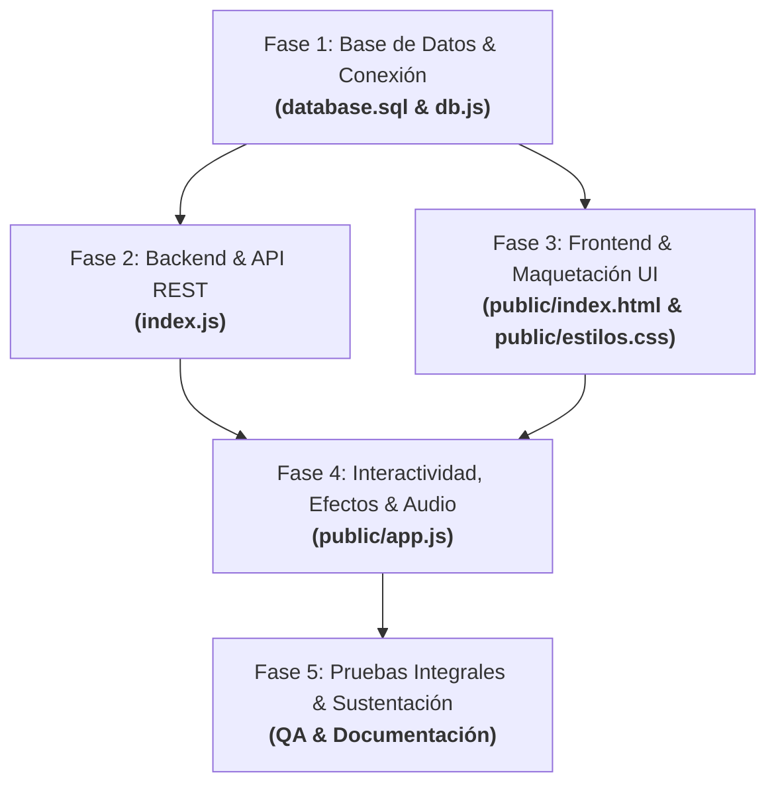
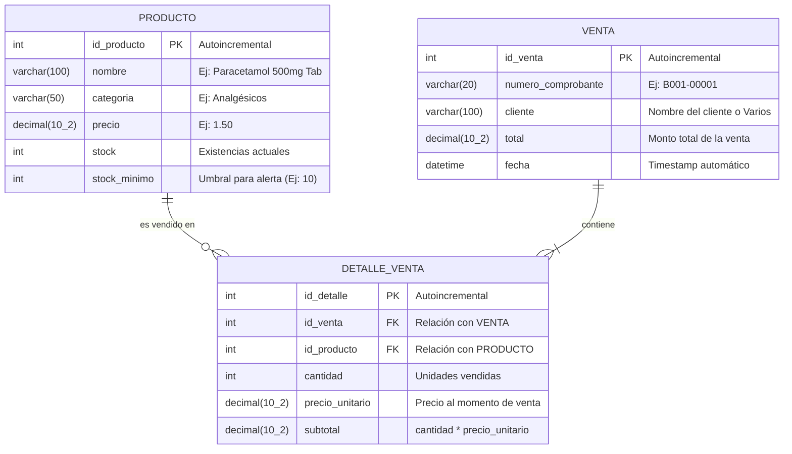

# PLAN INTEGRAL DEL PROYECTO: SISTEMA DE GESTIÓN DE INVENTARIO Y VENTAS
## Botica "Nova Salud" (FarmaPlus) — Software Web Fullstack

---

## 0. LISTA DE FASES Y REPARTO MODULAR DE TAREAS

Para facilitar la coordinación del equipo y el trabajo en paralelo entre desarrolladores y sus agentes de IA, el proyecto se divide en 5 fases estandarizadas e independientes:



### Matriz de Distribución de Trabajo:
* **Fase 1 — Datos y Persistencia:** Creación del esquema relacional DDL, carga de datos iniciales (`database.sql`) y módulo de conexión con pool asíncrono (`db.js`). *(A cargo de Desarrollador A)*.
* **Fase 2 — Servidor y Lógica de Negocio:** Construcción del servidor Express, middlewares, transacciones seguras de venta y rutas REST (`index.js`). *(A cargo de Desarrollador B)*.
* **Fase 3 — Estructura Visual y Diseño:** Maquetación semántica del POS, tabla de inventario, panel de alertas y estilos clínicos con animaciones CSS/Hover.css (`public/index.html`, `public/estilos.css`).
* **Fase 4 — Dinamismo, Integración y Efectos:** Consumo de la API con `fetch()`, control del carrito, animaciones con Anime.js, Spline 3D Viewer y feedback sonoro con Web Audio API (`public/app.js`).
* **Fase 5 — Verificación y Entrega:** Pruebas de reducción atómica de stock, validación de alertas de reposición y preparación de la sustentación técnica.

---

## 1. CONTEXTO GENERAL DEL CASO PRÁCTICO

* **Organización:** Botica "Nova Salud" (referenciada como "FarmaPlus" en las preguntas guía del caso).
* **Ubicación y Entorno:** Zona comercial de alta afluencia con incremento sostenido de clientes.
* **Problema Principal:** Control de stock y registro de ventas manual (papel o planillas no integradas), causando desabastecimiento no previsto de medicamentos críticos, errores de inventario y largas colas (6 a 8 minutos por cliente).
* **Solución Propuesta:** Sistema web centralizado con arquitectura desacoplada:
  * **Backend ligero:** Node.js + Express + MySQL para transacciones atómicas seguras.
  * **Frontend moderno:** Interfaz web intuitiva de despacho rápido (POS), actualización inmediata de existencias, módulo de alertas automáticas para reposición ($stock \le stock\_minimo$) y retroalimentación interactiva (sonidos sintetizados y animaciones).

---

## 2. ARQUITECTURA TÉCNICA Y DESACOPLAMIENTO

> [!IMPORTANT]
> **Regla de oro de la arquitectura:** El Backend y el Frontend están 100% desacoplados.
> * El Backend solo transfiere datos en formato **JSON** puro a través de endpoints HTTP.
> * Todos los efectos visuales (Anime.js, Hover.css, Spline Viewer) y auditivos (Web Audio API) son ejecutados de manera exclusiva por el **navegador del cliente**. El servidor no procesa audio ni renderizado.

### Diagrama de Arquitectura:
```mermaid
flowchart LR
    subgraph Frontend["Frontend (Cliente - Navegador /public)"]
        UI["Interfaz Web (HTML5 / CSS3)"]
        HOVER["Efectos de Botones (Hover.css)"]
        ANIME["Animaciones de Entrada (Anime.js)"]
        SPLINE["Modelo 3D Interactivo (Spline Viewer)"]
        AUDIO["Feedback Sonoro (Web Audio API)"]
        APP["Controlador Cliente (app.js)"]
    end

    subgraph Backend["Backend (Node.js + Express)"]
        SERVER["Servidor HTTP (index.js)"]
        ROUTES["Rutas REST (/api/...)"]
        DBM["Pool de Conexiones (db.js)"]
    end

    subgraph Database["Base de Datos Relacional"]
        MYSQL[("MySQL 8.x: botica_novasalud")]
    end

    APP -->|fetch GET / POST (JSON)| ROUTES
    ROUTES --> SERVER
    SERVER --> DBM
    DBM -->|Consultas SQL simples / Transacciones| MYSQL
    MYSQL -->|Resultados| DBM
    DBM --> SERVER
    SERVER -->|Respuesta JSON { success, data }| APP
    APP -->|Actualiza elementos| UI
    APP -->|Dispara transiciones suaves| ANIME
    APP -->|Emite bips, éxito o alerta| AUDIO
```

---

## 3. ESQUEMA SIMPLIFICADO DE LA BASE DE DATOS

Para mantener el código simple, limpio y sin complejidades innecesarias, la base de datos se normaliza en **3 tablas maestras** (relación clásica Maestro-Detalle de ventas):



### Reglas de Negocio en la Base de Datos:
1. **Detección de Alertas de Reposición:** Un producto entra en alerta de bajo stock cuando:
   $$\text{stock} \le \text{stock\_minimo}$$
2. **Actualización Atómica de Stock:** Cada vez que se confirma una venta:
   $$\text{stock}_{\text{nuevo}} = \text{stock}_{\text{anterior}} - \text{cantidad}$$
3. **Consistencia Transaccional:** El registro de la venta y el descuento de inventario deben ejecutarse dentro de una transacción (`START TRANSACTION`, `COMMIT`, `ROLLBACK`) para evitar ventas con stock fantasma.

---

## 4. CONTRATO DE API REST PARA EL BACKEND (`index.js`)

Este contrato define con exactitud cómo deben implementarse los endpoints para que el desarrollador del backend y del frontend trabajen en total sincronía:

### Configuración del Servidor Express:
* **Puerto:** `3000` (o `process.env.PORT || 3000`).
* **Middlewares requeridos:**
  ```javascript
  app.use(express.json());
  app.use(express.static('public')); // Sirve el frontend directamente
  ```

---

### Endpoint 1: Listar Catálogo de Productos
* **Método:** `GET`
* **Ruta:** `/api/productos`
* **Consulta SQL:**
  ```sql
  SELECT id_producto, nombre, categoria, precio, stock, stock_minimo 
  FROM productos 
  ORDER BY nombre ASC;
  ```
* **Respuesta Exitosa (200 OK):**
  ```json
  [
    {
      "id_producto": 1,
      "nombre": "Paracetamol 500mg",
      "categoria": "Analgésicos",
      "precio": 1.50,
      "stock": 45,
      "stock_minimo": 10
    }
  ]
  ```

---

### Endpoint 2: Listar Productos con Alerta de Reposición
* **Método:** `GET`
* **Ruta:** `/api/alertas`
* **Consulta SQL:**
  ```sql
  SELECT id_producto, nombre, categoria, precio, stock, stock_minimo 
  FROM productos 
  WHERE stock <= stock_minimo 
  ORDER BY stock ASC;
  ```
* **Respuesta Exitosa (200 OK):**
  ```json
  [
    {
      "id_producto": 4,
      "nombre": "Amoxicilina 500mg",
      "categoria": "Antibióticos",
      "precio": 3.80,
      "stock": 5,
      "stock_minimo": 15
    }
  ]
  ```

---

### Endpoint 3: Registrar Nuevo Medicamento
* **Método:** `POST`
* **Ruta:** `/api/productos`
* **Cuerpo de Solicitud (JSON):**
  ```json
  {
    "nombre": "Ibuprofeno 400mg",
    "categoria": "Antiinflamatorios",
    "precio": 2.00,
    "stock": 50,
    "stock_minimo": 12
  }
  ```
* **Consulta SQL:**
  ```sql
  INSERT INTO productos (nombre, categoria, precio, stock, stock_minimo) 
  VALUES (?, ?, ?, ?, ?);
  ```
* **Respuesta Exitosa (201 Created):**
  ```json
  {
    "success": true,
    "message": "Producto registrado correctamente",
    "id_producto": 10
  }
  ```

---

### Endpoint 4: Registrar Venta con Descuento de Stock
* **Método:** `POST`
* **Ruta:** `/api/ventas`
* **Cuerpo de Solicitud (JSON):**
  ```json
  {
    "cliente": "María Rodríguez",
    "items": [
      {
        "id_producto": 1,
        "cantidad": 2,
        "precio_unitario": 1.50
      },
      {
        "id_producto": 3,
        "cantidad": 1,
        "precio_unitario": 12.00
      }
    ]
  }
  ```
* **Lógica en el Backend:**
  1. Iniciar transacción: `const conn = await pool.getConnection(); await conn.beginTransaction();`
  2. Generar número de comprobante único (ej: `B001-${Date.now().toString().slice(-5)}`).
  3. Calcular el monto total sumando `cantidad * precio_unitario`.
  4. Insertar en tabla `ventas`.
  5. Por cada elemento en `items`:
     * Verificar que haya stock suficiente (`stock >= cantidad`). Si falta stock, hacer `await conn.rollback()` y responder error 400.
     * Insertar en `detalle_ventas`.
     * Ejecutar `UPDATE productos SET stock = stock - ? WHERE id_producto = ?`.
  6. Confirmar transacción: `await conn.commit();`
  7. Liberar conexión: `conn.release();`
* **Respuesta Exitosa (201 Created):**
  ```json
  {
    "success": true,
    "message": "Venta procesada con éxito",
    "comprobante": "B001-98765",
    "total": 15.00
  }
  ```

---

### Endpoint 5: Historial Reciente de Ventas
* **Método:** `GET`
* **Ruta:** `/api/ventas`
* **Consulta SQL:**
  ```sql
  SELECT id_venta, numero_comprobante, cliente, total, fecha 
  FROM ventas 
  ORDER BY fecha DESC 
  LIMIT 15;
  ```

---

## 5. ESPECIFICACIÓN DEL FRONTEND (`public/`)

### 5.1 Librerías a Incluir vía CDN (Sin instalaciones pesadas):
1. **Anime.js:** `<script src="https://cdnjs.cloudflare.com/ajax/libs/animejs/3.2.1/anime.min.js"></script>`
2. **Hover.css:** `<link rel="stylesheet" href="https://cdnjs.cloudflare.com/ajax/libs/hover.css/2.3.1/css/hover-min.css">`
3. **Spline Viewer:** `<script type="module" src="https://unpkg.com/@splinetool/viewer@latest/build/spline-viewer.js"></script>`
4. **FontAwesome / Lucide Icons:** Para iconos de carrito, medicina, alertas y búsqueda.

### 5.2 Secciones de la Interfaz (`index.html`):
1. **Header / Hero Interactivo:**
   * Título de la Botica "Nova Salud".
   * Visor 3D con Spline o Canvas interactivo de partículas médicas.
   * Indicador global en vivo: *Total Productos*, *Productos en Alerta*, *Total Ventas Hoy*.
2. **Módulo de Punto de Venta (POS):**
   * Buscador de medicamentos en tiempo real con filtro dinámico.
   * Grilla interactiva de medicamentos con tarjeta de stock y precio.
   * Carrito flotante lateral o inferior con resumen de compra, cálculo automático de total e input de cliente.
   * Botón de confirmación con efectos Hover.css (`hvr-grow hvr-sweep-to-right`).
3. **Módulo de Alertas de Reposición (Bajo Stock):**
   * Tarjetas con borde de advertencia e insignias de alerta.
   * Muestra la brecha de reposición (cuántas unidades faltan para el stock óptimo).
4. **Módulo de Inventario Rápido:**
   * Tabla con buscador para agregar nuevos medicamentos con modal emergente animado con Anime.js.

### 5.3 Sistema de Sonidos UI (Web Audio API nativa en `app.js`):
El archivo `app.js` implementará una clase o módulo `SoundEffects` que no requiere ningún archivo externo:
* `SoundEffects.click()`: Tono corto y sutil (frecuencia 600Hz, 40ms) al interactuar.
* `SoundEffects.success()`: Acorde armónico ascendente estilo caja registradora al confirmar venta.
* `SoundEffects.alert()`: Tono doble de precaución (frecuencias alternas) cuando un ítem llega a stock crítico.

---

## 6. RESPUESTAS TÉCNICAS A LAS PREGUNTAS GUÍAS DEL CURSO

Estas respuestas están listas para ser presentadas en el informe final:

### 1) ¿Cuáles son los principales desafíos operativos que enfrenta la botica debido a la falta de un sistema de gestión de inventarios automatizado?
* **Desabastecimiento recurrente (quiebre de stock):** Al no contar con alertas tempranas, los productos de mayor rotación se agotan sin previo aviso.
* **Tiempos de espera elevados:** El personal debe desplazarse repetidamente a verificar anaqueles físicos, elevando el tiempo por cliente a más de 6 minutos.
* **Errores de registro manual:** Frecuentes discrepancias entre las existencias en físico y las anotaciones en cuadernos o planillas aisladas.
* **Ineficiencia en la reposición:** Las compras a distribuidores se realizan a ciegas sin basarse en datos históricos de demanda.

### 2) ¿Qué características específicas debe incluir el software web para atender las necesidades de control de stock y atención al cliente?
* **Punto de Venta Rápido (POS):** Búsqueda instantánea con stock visible en tiempo real.
* **Módulo de Alertas Automáticas:** Detección de productos donde $stock \le stock\_minimo$.
* **Descuento Atómico de Stock:** Reducción automática e inmediata de unidades al generar una venta mediante transacciones SQL.
* **Trazabilidad y Comprobantes:** Generación de comprobante correlativo y registro detallado por cada artículo despachado.

### 3) ¿De qué manera la implementación de un software web para la gestión de inventarios puede impactar en la reducción del desabastecimiento y la mejora del servicio al cliente?
* **Impacto en abastecimiento:** Permite transitar de una reposición reactiva a una preventiva gracias al tablero de alertas automáticas.
* **Impacto en atención:** Reduce el tiempo promedio de atención por cliente de ~7 minutos a menos de 90 segundos, aumentando la capacidad operativa de la botica.

### 4) ¿Qué beneficios adicionales, aparte del control de inventarios, podría ofrecer el software para incrementar la competitividad en su mercado?
* **Identificación de productos estrella:** Análisis de los fármacos con mayor índice de rotación para negociar descuentos con laboratorios.
* **Control de caja transparente:** Cierre diario de ventas exacto y contrastable con el inventario despachado.
* **Escalabilidad del negocio:** Habilidad para incorporar múltiples terminales de atención conectados a la misma base de datos sin fricción.

### 5) ¿Qué métricas se pueden utilizar para evaluar la efectividad del software en mejorar los tiempos de respuesta al cliente y reducir los errores en la gestión de inventario?
1. **Tiempo Promedio de Atención (TPA):** Cronometraje desde que el cliente solicita el medicamento hasta la entrega del comprobante ($< 2$ min).
2. **Exactitud del Registro de Inventario (IRA):** $\frac{\text{Conteo Físico Real}}{\text{Stock en Sistema}} \times 100\%$ ($> 98\%$).
3. **Tasa de Quiebre de Stock (Stockout Rate):** Porcentaje de ventas perdidas por falta de existencias ($< 2\%$).
4. **Rotación de Inventario:** Frecuencia de renovación del stock en un período dado.
